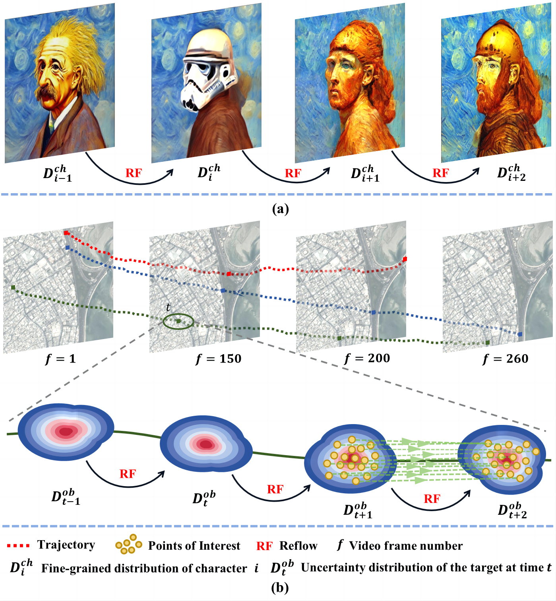
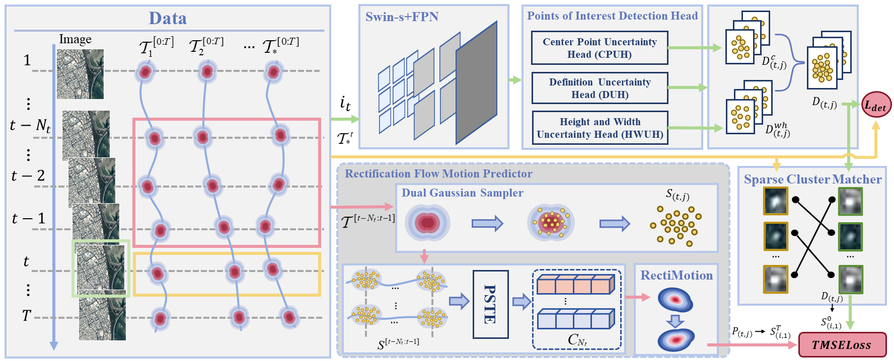
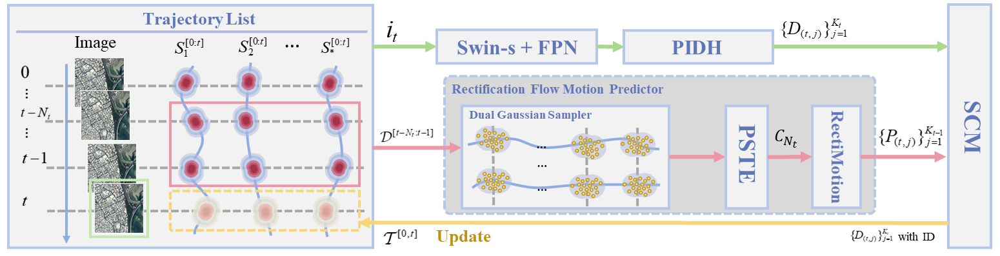
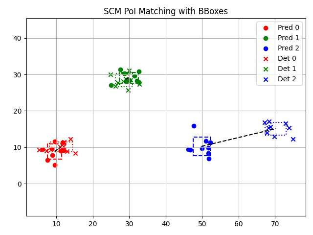

# PIFTrack

Official implementation of **PIFTrack**, a novel framework for multi-object tracking in satellite videos via Points-of-Interest (PoIs) based flow modeling and association.

<p align="center">
  <figure>
    
    <figcaption><b>Figure 1</b>: Nonlinear motion prediction based on diffusion ODE.</figcaption>
  </figure>
</p>
---

## 🗂️ Table of Contents

1. [News](#-news)
2. [Introduction](#-introduction)
4. [Environment Setup](#-environment-setup)
    1. [Detection Model Environment Setup](#detection-model-environment-setup)
    2. [Tracking Model Environment Setup](#tracking-model-environment-setup)
5. [Running Instructions](#running-instructions)
    1. [Detection Model Running](#detection-model-running)
    2. [Tracking Model Running](#tracking-model-running)
6. [Sparse Cluster Matcher (SCM) Example](#sparse-cluster-matcher-scm-example)
7. [Tracking Results](#tracking-results)
8. [Engineering Notes](#engineering-notes)
9. [Acknowledgments](#acknowledgments)

---

## 📰 News

📌 **April 2025**: The manuscript has been submitted to **IEEE Transactions on Geoscience and Remote Sensing (TGRS)**. 

📌 **August 2025**: We have open-sourced the weights of our trained detection and tracking models, published the model's tracking results, and provided a detailed explanation of the environmental setup.


---
## 🔍 Introduction

PIFTrack tackles the unique challenges of multi-object tracking (MOT) in satellite videos, such as ambiguous annotations, nonlinear motion, and degraded IoU-based association. To address these issues, PIFTrack introduces:
<!-- - **PIDH Module**: Probabilistic modeling of spatial ambiguity using Points-of-Interest (PoIs).
- **RFMP Module**: Trajectory prediction via Residual Flow-guided Motion Prior, modeling nonlinear dynamics without handcrafted assumptions.
- **SCM Strategy**: An IoU-free association strategy for robust tracking of tiny targets. -->

<p align="center">
  <figure>
    
    <figcaption><b>Figure 2(a)</b>: The training pipeline of PIFTrack.</figcaption>
  </figure>
  
  <figure>
    
    <figcaption><b>Figure 2(b)</b>: The inference pipeline of PIFTrack.</figcaption>
  </figure>
</p>

---

<!-- ## 🧠 Network Architecture

The architecture of PIFTrack consists of two stages:
1. **Training Stage**: Learns PoI-based representations and motion flows using PIDH and RFMP modules.
2. **Inference Stage**: Applies SCM for effective association, ensuring trajectory continuity under challenging motion and appearance variations.

<p align="center">
  
</p>

--- -->
## Environment Setup

### Detection Model Environment Setup

The code was tested on Ubuntu 16.04, with [Anaconda](https://www.anaconda.com/download) Python 3.8, CUDA 10.0, and [PyTorch](http://pytorch.org/) v1.0.  
It should be compatible with PyTorch <=1.4 and Python >=0.4 (you will need to switch DCNv2 version for PyTorch <1.0).  After installing Anaconda:

0. [Optional but highly recommended] create a new conda environment. 

    ~~~
    conda create --name PIDH python=3.8
    ~~~
    And activate the environment.
    
    ~~~
    conda activate PIDH
    ~~~

1. Install [COCOAPI](https://github.com/cocodataset/cocoapi):

    ~~~
    pip install cython; pip install -U 'git+https://github.com/cocodataset/cocoapi.git#subdirectory=PythonAPI'
    ~~~

2. Clone this repo:

    ~~~
    PIDH_ROOT=/path/to/clone/PIDH
    git clone --recursive https://github.com/xingyizhou/PIDH $PIDH_ROOT
    ~~~

    You can manually install the [submodules](../.gitmodules) if you forget `--recursive`.

3. Download and install Miniconda from the official website.

4. Create a conda environment and activate it:

    ~~~
    conda create --name openmmlab python=3.8 -y
    conda activate openmmlab
    ~~~

5. Install MMEngine and MMCV using MIM:

    ~~~
    pip install -U openmim
    mim install mmengine
    mim install "mmcv"
    ~~~

    Note: In MMCV-v2.x, `mmcv-full` is renamed to `mmcv`. If you want to install `mmcv` without CUDA ops, you can use `mim install "mmcv-lite>=2.0.0rc1"` to install the lite version.

6. Install MMDetection (version 2.20). To switch to the correct branch:

    ~~~
    unzip TOD.zip
    cd TOD
    pip install -r requirements.txt
    pip install -v -e .
    ~~~

7. Compile deformable convolutional (from [DCNv2](https://github.com/CharlesShang/DCNv2/)).

    ~~~
    cd $PIDH_ROOT/src/lib/model/networks/
    # git clone https://github.com/CharlesShang/DCNv2/ # clone if it is not automatically downloaded by `--recursive`.
    cd DCNv2
    ./make.sh
    ~~~

### Tracking Model Environment Setup
To set up the environment for the tracking model (RFMP), follow these steps:

1. Create a conda environment for RFMP and activate it:

    ~~~
    conda create -n RFMP python=3.10 -y
    conda activate RFMP
    ~~~

2. Install the required PyTorch version:

    ~~~
    pip install torch==2.0.1 torchvision==0.15.2 torchaudio==2.0.2
    ~~~

3. Install other required packages:

    ~~~
    unzip MOT.zip
    cd MOT
    pip install -r requirements.txt
    ~~~

## Running Instructions
### Detection Model Running

~~~
cd TOD
python tools/train.py config/reppoints/PIDH.py
~~~

The implementation details of the PIDH algorithm can be found in `TOD/mmdet/models/dense_heads/PIDH_head.py`.

Our trained weight files can be downloaded by clicking the link below:

[Download Trained Weights from Baidu Netdisk](https://pan.baidu.com/s/1hRe9xZNUkgp4l73nCoP67Q?pwd=hjjs)    

Password: hjjs

### Tracking Model Running

~~~
cd MOT
python main.py --config ./configs/mot.yaml
~~~

Our trained weight files can be downloaded by clicking the link below:

[Download Trained Weights from Baidu Netdisk](https://pan.baidu.com/s/1VrmjxaXFq0ZuPisQsPVH_g?pwd=i6yi)  

Password: i6yi

## Sparse Cluster Matcher (SCM) Example

The following visualization demonstrates the effectiveness of SCM in associating tiny objects across frames using PoI overlaps, instead of unstable IoU or center distance metrics.

<p align="center">
  
</p>

To help readers better understand SCM, we have provided a separate demo in `\Association\SCM_demo.py`.

To run the demo, simply execute the following command:

```bash
python SCM_demo.py
```
---

## Tracking Results

| Dataset      | Tracking Results  |
|--------------|-------------------|
| VISO         | [Download Link](https://pan.baidu.com/s/1UGs1Q84bjCrKlOOzVbY9lw?pwd=jbff) |
| AIR-MOT      | [Download Link](https://pan.baidu.com/s/1TyCVcu673NfEQBBqIrFzmQ?pwd=bhuh) |
| CGSTL        | [Download Link](https://pan.baidu.com/s/1KZ5M1apLl0Keid3brxTODA?pwd=j8gu) |
| VSMB         | [Download Link](https://pan.baidu.com/s/1zYQaYbUkxu-QJSNHulr3DA?pwd=deu3) |

## 🛠️ Engineering Notes

- The **detection** component of PIFTrack is developed based on the [MMDetection](https://github.com/open-mmlab/mmdetection) framework.
- We sincerely thank the **OpenMMLab** team for providing such a powerful detection toolkit.

---

## Acknowledgments

We would like to sincerely thank the reviewers and editor for their valuable feedback and suggestions, which significantly improved the manuscript and the overall quality of our work. Their insightful comments have helped us refine the approach and strengthen the findings presented in this manuscript.